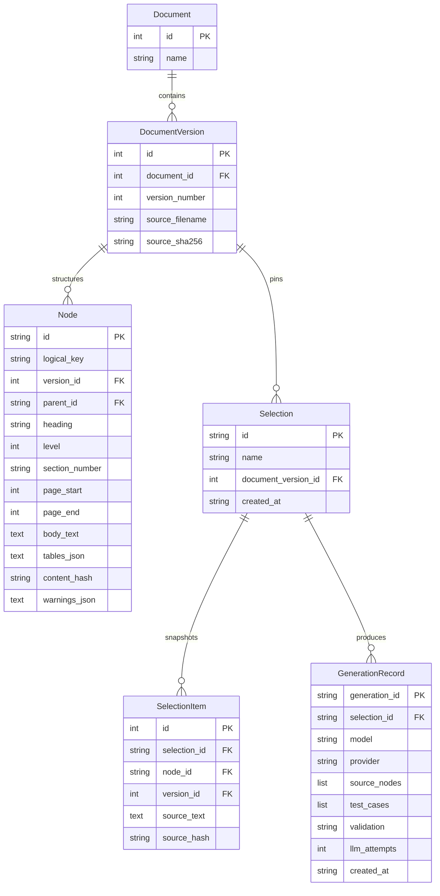

# CT-200 Parsing, Versioning & QA Traceability — Technical Approach & Design

## 1. Scope and Source Inspection

This architecture targets the CardioTrack CT-200 Technical and User Manuals (`ct200_manual.pdf` [v1, 6 pages] and `ct200_manual_v2.pdf` [v2, 7 pages]).
Per the assignment update (`IMPORTANT_ASSIGNMENT_UPDATE.txt`), input ingestion processes native PDFs directly rather than pre-rendered Markdown, reconstructing structural hierarchy, headings, sections, subsections, bullet/numbered lists, tables, and provenance metadata.

Extraction uses PyMuPDF (`fitz`) to extract structured text blocks, line bounding boxes, font sizes, and weight attributes. Digital text extraction is prioritized over OCR because both documents contain clean digital text layers; applying OCR indiscriminately introduces character substitutions, threshold distortion, and punctuation corruption. OCR via Tesseract is retained strictly as an automatic fallback when a page has no extractable digital text layer.

Extracted structure was systematically verified against the rendered PDF pages. The parser avoids silently inventing missing nodes or flattening unrecognized structural anomalies, instead surfacing them as auditable warnings attached directly to node records.

---

## 2. Data Model & Architecture

The system uses a hybrid storage model:
- **Relational Source of Truth (SQLite via SQLAlchemy):** Manages the hierarchical document tree, version metadata, nodes, and pinned selections.
- **Document Store (`generated.json`):** Persists generated QA test cases, model/provider provenance, and source text snapshots using atomic file replacement (`.tmp` write followed by `replace`).

### Justification of the JSON Generation Store
The assignment explicitly permits a justified JSON document store as an alternative to an external database like MongoDB. For a local single-process service, atomic file writing avoids external database daemon dependencies while providing a schema-free document model for nested LLM test cases and source snapshot arrays.

---

## 3. Parsing and Hierarchy Reconstruction

PDF extraction follows a multi-stage pipeline:
1. **Span Analysis & Column Separation:** Spans within each text block are analyzed. Horizontal gaps greater than 35 points indicate distinct visual columns (e.g. table cells) and are preserved using pipe delimiters (` | `).
2. **Heading vs Body Discrimination:** A line is classified as a section heading if:
   - It matches `^\s*(\d+(?:\.\d+)*\.?)\s+(.+?)\s*$` (`SECTION_RE`).
   - Line length is under 110 characters.
   - It possesses heading weight (bold) or font size $\ge 12\text{pt}$.
   Numbered items in lists (e.g. clinical classification items under `3.3`) have smaller non-bold body fonts and are preserved as body text.
3. **Table Extraction & False-Fragment Filtering:** Visual tables with grid lines are detected using PyMuPDF's line-based table detector (`find_tables(strategy='lines')`). A geometric filter detects and removes sub-table fragments accidentally captured within larger tables. Reconstructed rows are stored both as structured JSON arrays and as Markdown tables appended to the owning section's body text.
4. **Hierarchy Assembly & Parent Resolution:** Section numbers dictate tree structure. When a subsection level is skipped (e.g. `2.1.1.1` skipping `2.1.1`), the algorithm traverses backwards to the closest existing ancestor (`2.1`), attaches the node, and logs an explicit warning.
5. **Page-Break Continuation Tracking:** When non-heading body text spans across multiple pages (e.g. Section 3.1 spanning pages 2–3 in v1; Section 4.3 spanning pages 4–5 in v2), the parser updates `page_end` and logs a `Page-break continuation` warning.
6. **Title Multi-Line Merging:** Page 1 document title lines (`CardioTrack CT-200 Home Blood / Pressure Monitor — Technical & / User Manual`) are merged into a single canonical document title node.

---

## 4. Actual PDF Irregularities and Handling

The supplied manuals contain several real-world structural irregularities:

| Irregularity | Occurrence in Source PDF | Engine Handling | Unit Test Verification |
|---|---|---|---|
| **Skipped Numbering Level** | Section `2.1.1.1 Battery Life Under Typical Use` appears directly under `2.1` without a `2.1.1` parent. | Attached to nearest existing numbered ancestor `2.1`; emits warning `Numbering skips 2.1.1; attached to nearest existing ancestor 2.1.` | `test_skipped_numbering_attaches_to_nearest_existing_ancestor` |
| **Out-of-Order Sibling Sections** | Section `3.4 Auto Shutoff` appears *before* `3.3 Result Display and Classification` on page 3. | Preserves true document source order; emits warning `Section 3.4 appears before section 3.3 in source order.` | `test_out_of_order_sections_are_preserved_and_flagged` |
| **Duplicate Heading Labels** | Section `4.2 Error Codes` and Section `7.1 Error Codes` share the identical title text. | Distinct `logical_key` (`SECTION:4.2` vs `SECTION:7.1`) and parent links (`4` vs `7`) preserve separation. | `test_duplicate_heading_text_remains_distinct_under_correct_parents` |
| **Page-Break Continuations** | Section `3.1` spans across pages 2–3 (v1); Section `4.3` spans across pages 4–5 (v2); Section `6.1` spans across pages 5–6 (v2). | Continues body accumulation without splitting nodes; records `page_start`, `page_end`, and emits `Page-break continuation` warning. | `test_page_break_continuations_detected_and_flagged` |
| **Multi-line Title Wrapping** | Title spans 3 visual lines on page 1. | Merges wrapped header spans into single level-0 document title node. | `test_multiline_title_merged_into_single_document_title` |
| **Numbered List within Body** | Section `3.3` contains 5 clinical classification levels (`1. Normal`, `2. Elevated`, etc.). | Font size and weight discrimination retains list in `3.3` body text without misparsing as top-level sections 1–5. | `test_numbered_lists_preserved_as_body_not_nodes` |
| **Table Cells & Additions** | Specifications table (8×2) and Error Codes table (6×3 in v1, 7×3 with E6 in v2). | Line-strategy detector extracts cells into structured JSON; containment filter prunes duplicate cell fragments. | `test_specification_and_error_code_tables_are_reconstructed_as_rows` |

---

## 5. Version Matching Strategy & Failure Modes

- **Logical Key Matching:** Cross-version entity resolution uses normalized section paths (`SECTION:<num>`). Content changes do not alter logical identity: a modified requirement keeps its logical key while receiving a new version-specific node ID, content hash, and parent pointer.
- **Node Classification:** The `/versions/compare` endpoint categorizes all nodes into four distinct lifecycle buckets:
  - `added_nodes`: Present in new version, absent in older version (e.g. `SECTION:5.3 Data Export`).
  - `removed_nodes`: Present in old version, absent in new version.
  - `changed_nodes`: Present in both, but `content_hash` differs.
  - `unchanged_nodes`: Identical `content_hash` in both versions.
- **Failure Modes:**
  1. *Section Renumbering:* If section `2.1.1.1` is renumbered to `2.1.2`, the matcher flags `2.1.1.1` as removed and `2.1.2` as added.
  2. *Duplicate Numbering in Same Document:* Handled using occurrence suffixes (`SECTION:X::occurrence:2`).
  3. *Unnumbered Documents:* Falls back to normalized heading slugs (`ROOT::<normalized_heading>`).

---

## 6. LLM Prompt, Schema Validation & Failure Policy

- **Configurable Provider:** Calls Groq's OpenAI-compatible chat API (`https://api.groq.com/openai/v1/chat/completions`) using `GROQ_API_KEY` and `GROQ_MODEL` (`llama-3.3-70b-versatile`).
- **Prompt Strategy:** The prompt enforces strict grounding in the supplied manual text, prohibiting invented specifications or claims of regulatory compliance.
- **Structured Output Schema:**
  - `title`: Descriptive test title (4–180 chars).
  - `rationale`: Justification explaining device/clinical risk addressed.
  - `source_reference`: Traceable section and requirement citation.
  - `preconditions`: List of prerequisites (min 1).
  - `steps`: Concrete test execution steps (min 1).
  - `expected_result`: Observable pass/fail criteria (min 5 chars).
  - `severity`: Standardized triage label (`low`, `medium`, `high`, `critical`).
- **Bounded Retries & Fail-Closed Error Policy:**
  - If the LLM returns malformed JSON or fails Pydantic schema validation, the system executes one bounded correction attempt appending the exact validation error.
  - If the retry fails or the provider times out/errors, the API immediately returns HTTP 502 Bad Gateway and **persists nothing**. Invalid test cases are never saved.
- **Idempotency:** Re-submitting an existing selection ID returns the existing generation record by default, preventing accidental token usage and race conditions. Passing `force_new=true` explicitly generates and persists a new generation record.

---

## 7. Source Provenance & Substantive Staleness Design

- **Frozen Provenance:** Each selection captures frozen snapshots of source text, section numbers, and SHA-256 hashes at selection time. Generations duplicate these frozen snapshots alongside the LLM model name, provider, and timestamp.
- **Retrieval-Time Comparison:** When `/generations` is queried, each frozen source snapshot is compared in real time against the latest version of that logical node.
- **Substantive Change Detection Engine:** The engine (`detect_substantive_changes`) inspects diffs for:
  - *Numerical Threshold Changes:* Regular expressions (`\b\d+(?:\.\d+)?%?\b`) extract numbers and percentages. Changes such as `300 -> 250` cycles or `15% -> 10%` low-battery threshold are detected and surfaced as explicit triggers.
  - *Timing & Unit Modifiers:* Diffs in units (`mmHg`, `bpm`, `seconds`, `minutes`, `cycles`, `%`) are isolated (e.g. inflation increment `40 -> 30 mmHg`, E3 overpressure auto-deflation `2s -> 1.5s`).
  - *Negation Terminology:* Diffs in restriction/negation words (`not`, `no`, `never`, `without`, `discontinue`, `cannot`).
  - *Safety Terminology:* Diffs in safety-critical terms (`overpressure`, `alarm`, `safety`, `emergency`, `contraindication`, `fault`).
- **Classification Hierarchy:**
  - `current`: Content hash identical to latest version (`is_stale: false`).
  - `substantive_change_suspected`: Numbers, units, timing, negation, or safety words changed, or text similarity < 90% (`is_stale: true`).
  - `wording_changed`: Minor formatting or phrasing edits with no trigger words changed (`is_stale: true`).
  - `unresolved`: Logical node removed or unmapped in latest version (`is_stale: true`).
- **Clinical Disclaimer:** All comparison and staleness responses carry an explicit disclaimer stating that automated heuristic comparison cannot establish clinical or regulatory significance.

---

## 8. Decision Log

### 1. Most likely silent wrong result
**What is the most likely way this parser could silently produce a wrong result without throwing an error, and what did you do to prevent or catch it?**

*Answer:*
The most dangerous failure mode is **silent hierarchy misattribution** — when a paragraph, table cell, or safety requirement is incorrectly attached to a preceding section or preamble because a heading wasn't recognized, or when list items (such as the 5 clinical classification levels under `3.3`) are misclassified as new top-level sections `1` through `5`. The JSON tree would look completely valid, but QA test generation would query the wrong requirements or miss safety constraints entirely.

To prevent this:
1. Heading detection combines regex section numbers with visual layout weight (bold spans and font size $\ge 12\text{pt}$), ensuring body list items like `1. Normal` are never promoted to root nodes.
2. The tree constructor validates ancestor-child levels; when a level is skipped (`2.1.1.1` skipping `2.1.1`), it attaches to the nearest ancestor and emits an auditable node warning rather than guessing an imaginary parent.
3. Source order anomalies (Section `3.4` before `3.3`) are explicitly flagged with warnings rather than silently sorted.
4. Extracted tables are filtered against geometric bounding boxes to eliminate duplicate fragments.
5. Automated test `test_numbered_lists_preserved_as_body_not_nodes` verifies that top-level sections remain strictly `1` through `8`.

### 2. Simplicity chosen over correctness
**Where did you choose simplicity over correctness, what is the failure mode, and what would break first in production?**

*Answer:*
Simplicity was chosen in two key places:
1. **Section-Number Identity Matching (`SECTION:<num>`):** Logical cross-version identity is tied to explicit section numbering rather than multi-signal semantic entity resolution.
   - *Failure Mode:* If a document revision renumbers sections (e.g. inserting a new section 3 and shifting all subsequent sections by 1), the matcher will associate section 4 with old section 4 instead of recognizing the shift.
   - *What breaks first in production:* In an active regulatory engineering environment with major document restructuring or renumbering, historical nodes would match incorrect sections or report false removals. Production requires a composite matcher combining normalized heading similarity, parent-context embedding, and human-in-the-loop review.
2. **Single-File JSON Generation Storage (`generated.json`):**
   - *Failure Mode:* While atomic file replace (`.tmp` to `.json`) prevents file corruption on single processes, it lacks row-level locking or distributed transactions.
   - *What breaks first in production:* Under concurrent multi-user load or multiple Uvicorn worker processes, write collisions will cause lost updates. Production requires PostgreSQL with JSONB columns or MongoDB with transactional locking.

### 3. Unhandled input
**What inputs or edge cases does your implementation explicitly not handle, and why?**

*Answer:*
1. **Scanned Images Without Usable OCR:** Scanned PDFs where OCR fails (or where Tesseract is not installed in the host OS) cannot be parsed. The system emits a warning rather than failing silently, but does not attempt computer vision font reconstruction.
2. **Borderless & Complex Merged Tables:** PyMuPDF's line-based table detector assumes bordered table geometries. Tables without visible grid lines or with multi-column merged headers (spanning rows/columns irregularly) are extracted as raw formatted text lines rather than structured matrices.
3. **Duplicate Section Numbers Under the Same Parent:** If an author mistakenly numbers two distinct sections identically under the same parent (e.g., two `3.2` sections), the path generator appends an occurrence suffix (`SECTION:3.2::occurrence:2`), but cannot infer which section was the author's intended canonical target without manual human disambiguation.

---

## 9. Remaining Limitations and Future Improvements

With additional time in a production setting, the following capabilities would be added:
- **Distributed Document Storage:** Replace the file-based generation store with MongoDB or PostgreSQL JSONB with ACID transactions and optimistic concurrency control.
- **Multi-Signal Semantic Entity Matching:** Combine section number, vector similarity of heading text, tree depth, and sibling context to match moved and renumbered sections.
- **Vision-Language Table Extraction:** Use multimodal vision models (e.g. Gemini 2.5 Flash) on rendered page pixmaps to validate complex merged-cell tables.
- **Audit Trail & Signature Workflow:** Implement 21 CFR Part 11 compliant audit logging, version signing, and clinical reviewer sign-off for QA test cases.
